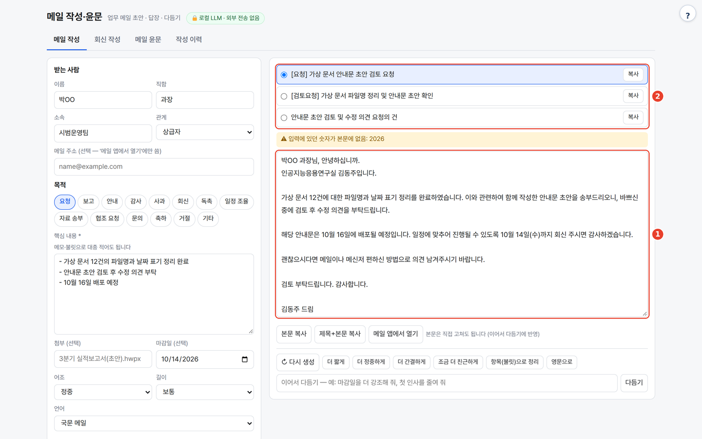
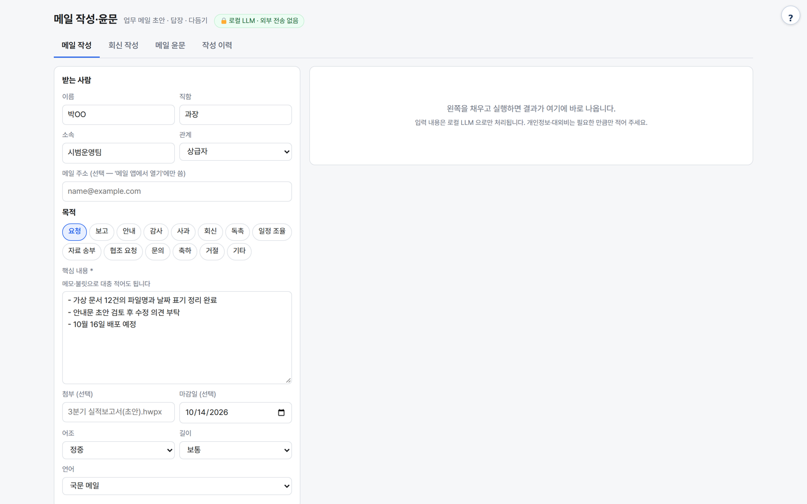

# mail-local — 업무 메일 작성·회신·윤문

받는 사람과 메모만 적으면 제목 후보 3개와 업무 메일 본문을 쓰고, 받은 메일에는 답장 초안을, 내가 쓴 메일은 문장 단위로 다듬어 비교해 주는 로컬 LLM 도구입니다. 외부로 보내지 않고, 메일을 자동 발송하지도 않습니다.

> ⚠️ 연구·내부 시험용 프로토타입입니다(배포·상업 서비스용 아님). 제3자 구성요소의 라이선스는 THIRD_PARTY_NOTICES.md 를 확인하세요.



## 무엇을 하나

- **메일 작성** — 받는 사람·목적·메모로 제목 후보 3개 + 본문. 입력에 없는 정보는 `[○○]` 빈칸으로 남기고, 입력 숫자가 빠지거나 없던 숫자가 생기면 알립니다.
- **회신 작성** — 받은 메일 원문 + 답장 요지 → 답장 초안 + 원문 요청사항별 `반영 / 확인 필요` 체크리스트.
- **메일 윤문** — 문장 단위로 다듬고 바뀐 곳을 diff(삭제 빨강·추가 초록)로 표시. 숫자·날짜·금액·이메일·영문 표기가 바뀐 문장은 **자동으로 원문 유지 + 경고**하고, 클릭으로 수정안 적용·되돌리기.
- 표준 라이브러리만(설치할 패키지 없음), CDN 없음.

## 사용 방법

포털 경유(`http://<포털>:8700/t/mail-local/`) 또는 단독 실행(`http://localhost:8780`) 화면에서:

1. **받는 사람과 요점을 적는다** — 목적·핵심 내용(메모·불릿)·마감일·어조·길이를 고르고 **메일 작성**. 보내는 사람과 서명은 처음 한 번 채우면 브라우저에 기억됩니다.
2. **제목과 본문을 검토한다** — 제목 후보 중 하나를 선택하고(그림 ②), 본문(그림 ①)은 직접 고쳐도 됩니다. 숫자 관련 알림과 입력에 없는 표현을 확인합니다.
3. **복사하거나 회신·윤문한다** — **본문 복사 / 제목+본문 복사 / 메일 앱에서 열기**로 메일 앱에 붙여 넣습니다. 회신은 받은 원문과 답장 요지, 윤문은 내 원문을 해당 탭에 넣습니다. 마음에 안 들면 **↻ 다시 생성**이나 **더 짧게·더 정중하게…**, **이어서 다듬기**.

## 예시

가상 자료 정리 사례를 `gemma4:31b`로 **메일 작성**(목적 요청)에 실제 실행한 결과입니다. 보내는 사람·서명은 김동주(인공지능응용연구실)로 채웠습니다.

입력:

```text
받는 사람: 박OO 과장 · 시범운영팀 (관계: 상급자)
핵심 내용:
- 가상 문서 12건의 파일명과 날짜 표기 정리 완료
- 안내문 초안 검토 후 수정 의견 부탁
- 10월 16일 배포 예정
마감일: 2026-10-14
국문 서명: -- / 김동주 석사후연수생 | 인공지능응용연구실 / gggg8657@gmail.com
```

출력 (제목 후보 3개 중 1번 + 본문):

```text
[요청] 가상 문서 안내문 초안 검토 요청

박OO 과장님, 안녕하십니까.
인공지능응용연구실 김동주입니다.

가상 문서 12건에 대한 파일명과 날짜 표기 정리를 완료하였습니다. 이와 관련하여 함께 작성한 안내문 초안을 송부드리오니, 바쁘신 중에 검토 후 수정 의견을 부탁드립니다.

해당 안내문은 10월 16일에 배포될 예정입니다. 일정에 맞추어 진행될 수 있도록 10월 14일(수)까지 회신 주시면 감사하겠습니다.

괜찮으시다면 메일이나 메신저 편하신 방법으로 의견 남겨주시기 바랍니다.

검토 부탁드립니다. 감사합니다.

김동주 드림

--
김동주 석사후연수생 | 인공지능응용연구실
gggg8657@gmail.com
```

이 실행은 마감일의 연도 "2026"이 본문에 없다는 숫자 알림을 냈습니다. 초안의 "송부드리오니"처럼 실제 첨부 여부와 맞는지도 보내기 전에 확인하세요.

<details><summary>입력 화면</summary>



</details>

## 설치·실행

```bash
bash setup.sh                 # Python → LLM 서버 탐색 → selftest → http://localhost:8780
bash setup.sh stop
python3 app.py                # 수동 실행
python3 app.py --cli polish natural < mail.txt     # 윤문 (모드: spell|natural|polite|concise|english)
python3 app.py --cli write < inputs.json           # 작성 (inputs 형식은 selftest.py 의 W 참고)
python3 selftest.py           # 가짜 LLM 으로 검증 (WORKSPACE 를 임시 폴더로 바꿔 돌고 지움)
```

| 환경변수 | 기본 | 설명 |
|---|---|---|
| `PORT` | `8780` | |
| `WORKSPACE` | `./_workspace` | 작성 이력 `history/<id>.json` (한 작업 = 한 파일, 다시 생성·이어서 다듬기가 판으로 쌓임) |
| `LLM_API` / `LLM_BASE_URL` / `LLM_MODEL` | `ollama` / `http://localhost:11434` / `qwen3:8b` | OpenAI 호환 서버면 `LLM_API=openai` |
| `LLM_API_KEY` | (없음) | OpenAI 호환 서버에 키가 필요할 때 |
| `NUM_CTX` | `16384` | Ollama 컨텍스트 (긴 원문 회신용) |

[agent-page-portal](https://github.com/gggg8657/agent-page-portal)에서 띄우면 `PORT`·`WORKSPACE`(`_data/mail-local`)를 포털이 정하고, LLM 설정은 포털 프로세스의 환경변수를 물려받습니다. 현재 운영 기본값은 로컬 Ollama의 `gemma4:31b`입니다. 단독 실행 시 코드 기본값은 `qwen3:8b`입니다.

기록은 사용자별로 따로 저장됩니다(포털 접속자 기준, 포털이 넘기는 `X-Agent-User` 헤더 → `$WORKSPACE/u/<사용자>/`). 서버 주인(관리자)과 단독 실행은 예전처럼 `$WORKSPACE` 바로 아래를 쓰므로 지금까지의 기록도 그대로 보입니다. 포털이 `BIND=127.0.0.1` 을 넘기면 포털을 거쳐서만 접속됩니다.

## 기능
- **메일 작성** — 받는 사람(이름·직함·소속·관계), 목적 14종(요청·보고·안내·감사·사과·회신·독촉·일정 조율·자료 송부·협조 요청·문의·축하·거절·기타), 메모, 첨부, 마감일(요일은 프로그램이 계산), 어조 4종, 길이 3종, 국문/영문(국문 메모 → 영문 메일). 입력에 없는 정보는 `[○○]` 빈칸으로 남기게 하고, 입력 숫자가 빠지거나 없던 숫자가 생기면 알림.
- **회신 작성** — 받은 메일 원문 + 답장 요지 → 답장 초안 + 원문의 요청·질문별 `반영 / 확인 필요` 체크리스트. 제목 후보 1은 `RE: 원제목`.
- **메일 윤문** — 맞춤법·띄어쓰기만 / 자연스럽게 / 더 정중하게 / 더 간결하게 / 영문 다듬기. 메일을 문장 단위 `[n]` 으로 나눠 고치게 해 문장별 diff·되돌리기가 정확합니다. 서명 구분선(`--`)·`-----Original Message-----`·`보낸 사람:` 아래와 연락처 줄은 손대지 않습니다.
- 공통 — 결과 복사, 메일 앱에서 열기(mailto), 다시 생성, 이어서 다듬기(빠른 버튼 + 자유 지시), 판(version) 탭, 작성 이력에서 다시 열기·삭제. 서명(국문·영문)은 브라우저에 기억해 본문 끝에 그대로 붙입니다(LLM 이 만들지 않음).

## 숫자 보존 검사 (윤문)
문장마다 원문과 결과에서 `숫자+단위`(쉼표·띄어쓰기 무시), 이메일·URL, 따옴표 인용, 영문 단어(국문 모드)/대문자 약어(영문 모드)를 뽑아 다중집합으로 비교합니다.
다르면 그 문장은 원문을 유지하고 `⚠ 사라짐/생김` 을 보여 줍니다(클릭하면 적용). `10/15 → 10월 15일` 같은 표기 변경도 잡습니다.
한글 고유명사(사람·기관 이름)는 자동 검사 대상이 아니라 프롬프트로만 막습니다 — diff 를 눈으로 확인하세요.

메일 클라이언트(Outlook·그룹웨어)와 연동하지 않습니다. 복사해 붙여 넣으세요.

## 출처·감사 (Credits)

- 파이썬 표준 라이브러리만 씁니다. 윤문 검사 아이디어는 같은 저작자의 [kordoc-local](https://github.com/gggg8657/kordoc-local)·[humanize-kr-local](https://github.com/gggg8657/humanize-kr-local) 을 따름(코드 복사 아님).
- **LLM 실행** — OpenAI 호환 API 로 호출합니다(모델 가중치는 동봉하지 않음). 기본 배포는 [Ollama](https://github.com/ollama/ollama) (MIT) 위의 Google [Gemma 4](https://huggingface.co/google/gemma-4-31B-it) `gemma4:31b` (모델 카드 기준 Apache-2.0). `LLM_MODEL` 을 주지 않으면 코드 기본값은 `qwen3:8b` ([Qwen3](https://huggingface.co/Qwen/Qwen3-8B), Apache-2.0). 다른 모델을 쓰면 그 모델의 라이선스를 확인하세요.
- 이 도구는 [agent-page-portal](https://github.com/gggg8657/agent-page-portal) 에 연결해 쓰도록 만들었습니다(단독 실행도 됨).

저작권 표기는 `NOTICE`, 제3자 구성요소 전체 목록·라이선스·상업 이용 확인 사항은 [THIRD_PARTY_NOTICES.md](THIRD_PARTY_NOTICES.md) 를 보세요.

## 라이선스

[MIT License](LICENSE) © 2026 gggg8657.

## 만든 사람

DongJu Kim (gggg8657) — 설계·구현
